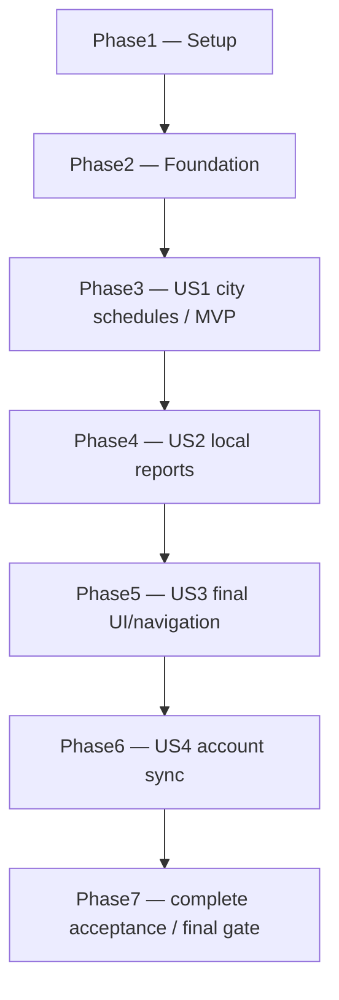

# Tasks: Prayer Experience (008)

**Branch**: `namaa/008-prayer-experience`
**Input**: [spec.md](spec.md), [plan.md](plan.md), [research.md](research.md), [data-model.md](data-model.md), [prototype-reference.md](prototype-reference.md), [contracts/](contracts/) and [quickstart.md](quickstart.md).
**Tests**: Included because the specification explicitly requires state, migration, reference, concurrency, security, device and acceptance evidence.
**Organization**: 134 small tasks in seven phases. Each task has exact target paths, explicit predecessor IDs and an observable completion condition. Task generation does not execute these tasks.

## Instructions for the implementing model

1. Work only on the phase/tasks requested by the human. At each task, read its referenced contract and the current target files before editing; do not assume the file still matches planning.
2. Read `.specify/memory/constitution.md`, then the feature spec/plan once per fresh session. Use this file for sequence; design contracts define the actual semantics. Preserve pre-existing unrelated `.metadata` changes.
3. Execute only after every listed predecessor and the preceding phase checkpoint is complete. `[P]` means the listed files can be worked independently **after** prerequisites; it is not permission to overlap migrations, shared ARBs, composition, generated files or verification.md writes.
4. For a test task, add the named cases before its implementation task and confirm the expected failure. A missing implementation may initially fail compilation; the phase checkpoint must be fully green. Never loosen an invariant, remove an assertion or retry a real failure merely to turn CI green.
5. For an implementation task, edit only the described responsibility and necessary call sites. Do not invent features, replace a chosen provider/library, introduce a generic framework or perform an unrelated refactor. A factual API mismatch must be recorded and resolved against research/plan before adoption.
6. On completion, run the named focused test or the smallest relevant test set. Mark only that task `[x]` once its Done condition is true. Record commands/actual results at phase gates; do not mark unrun device tests or acceptance criteria complete.
7. Use AppResult/AppFailure, existing Cubit, encrypted DB/vault, outbox/router and shared AppButton/AppSelectField/AppStatusView/AppHoverSurface. Do not add another persistence/XP/UI authority. Domain/application import no Flutter, Dio, timezone, UUID, Drift or Supabase implementations.
8. All paths below are repository-relative. New filenames are explicit planned files. Use the existing feature patterns in `lib/features/habits/`, `lib/features/tasks/` and `lib/features/today/` as structural references; do not copy their unrelated business rules.
9. Use exact method/date/identity/reward rules below. Do not leave them as an implementer's choice. Each new user-facing string belongs in AR/EN ARBs; generated Dart files come only from their generator.
10. Full CI belongs to the final feature/merge gate or a specifically requested focused diagnostic run. No full device run per task/ordinary branch commit. Commit/push/merge only within the human's current authorization; task completion alone does not authorize publication or production migrations.
11. A failed task is unfinished, not skipped. Keep previous valid data/configuration working and record the concrete failure. Stop dependent work if the unresolved decision affects correctness.
12. Do not run a production reset, expose credentials in logs or purchase/provision a commercial service to satisfy a task. Tests use local Supabase; real-device account evidence uses isolated non-production accounts.

## Fixed implementation facts

| Topic | Required decision |
| --- | --- |
| City/search | Manual online discovery, Open-Meteo evaluation adapter; save confirmed name/coordinates/IANA zone per owner **on this device only**. No GPS, cloud city preference or daily-times download. |
| Search configuration | `NAMAA_CITY_SEARCH_MODE=evaluation\|licensedGateway` and `NAMAA_CITY_SEARCH_GATEWAY_URL` are nonsecret build configuration. Debug/profile may use evaluation; licensed/commercial search requires HTTPS gateway and no free fallback. Missing gateway affects new search only. Never ship paid upstream keys. |
| Search behavior | Trim2–100 characters,350ms debounce,10 candidates,5s connect/8s receive timeout; cancel stale query/locale/owner results;429 respects Retry-After without retry storms. |
| Calendar | Prayer uses saved-city IANA civil date; Tasks/Habits/Today XP retain existing device calendar. Explicit D and D+1 UTC schedules; no global zone mutation. |
| Calculation | Seven approved presets, explicit standard/Shafi Asr, nearest-minute rounding, AlAdhan-aligned Dubai Sunrise/Asr offsets and Asr -1-minute calibration, Ramadan-aware UmmAlQura Isha (120/90 minutes) and fixed90-minute Qatar Isha. Pinned SolarTime preflight rejects silent high-latitude substitution; unavailable values remain explicit. |
| Night cards | Today's calculated Maghrib to tomorrow's Fajr, using UTC elapsed duration; midpoint and start of final third. This is not future Qiyam's Isha→Fajr reminder window. |
| Reports | One owner/date/prayer, four explicit states. Today-only entry/correction/reset. Missing means pending; reset is a persisted pending report. Never auto-missed or date-migrated. |
| Identity | UUIDv5 namespace `9d63d7a6-bb43-4b93-b2a1-c1d22c68b008`, name `YYYY-MM-DD/prayer_name`; owner remains part of composite key. No random per-device report IDs. |
| Reward | Central `prayer_done`, first completion: 10 on time / 5 late, once per owner/date/prayer. Offline award provisional until server settlement; corrections/reset do not change canonical award. Existing Task 20 XP remains. |
| Outbox | Immutable completion events cannot be replaced by later resets; base is last acknowledged server version. Explicit typed RPC base argument, no metadata inside semantic payload. |
| Conflicts | Newest UTC version, deterministic ASCII tie, both versions visible and same stable ID across SQL/Dart. Prayer resolves its typed outcome locally before generic coordinator ACK; do not change other domains' tie policy. |
| Settlement metadata | `prayer_reports.canonical_reward_confirmed_at` is local-only, set with returned canonical award and never uploaded. Preview scope treats its local award as final without fake server confirmation. |
| Source timeout | Reuse Today-style independent source recovery with a 10-second initial deadline and explicit retry; do not block all sections behind one source. |
| UI | Prototype four groups and current Namaa palette/font/icon/components; persistent desktop sidebar, five phone destinations and Track index 2. Text grows/wraps; no invented streak or fake working reminder. |

## Format

`- [ ] Tnnn [P?] [USn?] Action with exact path`

Each line is followed by **Depends**, **Done** and, when useful, **Check**. Setup/foundation/polish tasks intentionally have no story label. Checkboxes record verified completion; tasks outside the requested phase remain unchecked.

## Phase 1: Setup

**Goal**: Establish verified inputs, dependency/configuration boundaries and baseline evidence without changing feature behavior.

**Independent check**: Baseline recorded; dependencies resolve; platform network requirements and search modes are explicit.

- [x] T001 Record branch, existing unrelated edits, schema 7, migrations 0001–0014 and prototype inventory in specs/008-prayer-experience/verification.md.
  - **Depends**: None; read the feature inputs first.
  - **Done**: Preserve .metadata; distinguish existing evidence from future 008 evidence; create SC-001…008 sections with pending status.

- [x] T002 Verify the exact package archives/APIs/licenses in pubspec.yaml and record findings in specs/008-prayer-experience/verification.md.
  - **Depends**: T001
  - **Done**: Verify adhan_dart 2.0.1 SolarTime deep import, timezone 0.11.2 embedded data version, uuid 4.6.0 and Dio 5.11.1 against research.md; stop adoption if API/SDK differs, without silently changing versions.

- [x] T003 Add the four reviewed exact dependencies to pubspec.yaml and regenerate pubspec.lock.
  - **Depends**: T002
  - **Done**: No unrelated SDK/dependency upgrade; dependency graph resolves and no generated app code is hand-edited.
  - **Check**: flutter pub get

- [x] T004 Create lib/features/prayer/data/prayer_timezone_initializer.dart to initialize timezone/data/latest_all.dart once.
  - **Depends**: T003
  - **Done**: Expose an idempotent composition-callable initializer; do not call setLocalLocation or change the device/global zone.

- [x] T005 [P] Add release INTERNET permission in android/app/src/main/AndroidManifest.xml.
  - **Depends**: T001
  - **Done**: One INTERNET permission under manifest, no location/background/cleartext permission; verify merged release manifest during final target gate.
  - **Check**: Inspect existing debug/profile manifests first.

- [x] T006 [P] Add search-mode tests in test/unit/features/prayer/data/prayer_search_configuration_test.dart.
  - **Depends**: T003
  - **Done**: Debug/profile evaluation mode selects public HTTPS endpoint; licensed/commercial mode requires configured gateway; missing/invalid gateway returns unavailable with no free fallback.
  - **Check**: Run this file; it must fail for the missing implementation.

- [x] T007 Implement lib/features/prayer/data/prayer_search_configuration.dart.
  - **Depends**: T006
  - **Done**: Typed evaluation/licensedGateway mode; validate HTTPS origin, expose no paid key in client constants or dart-defines; saved-city calculation does not depend on this configuration.

- [x] T008 [P] Create specs/008-prayer-experience/guidance-sources.md mapping each planned rak'ah/recitation/Sunnah/Jahr-Sirr text role to the primary references in research.md.
  - **Depends**: T001
  - **Done**: Separate resident obligatory metadata from optional guidance; record reviewed paraphrase intent/source; do not copy complete fatwas or invent a ruling.

---

## Phase 2: Foundational prerequisites

**Goal**: Create pure values/contracts, shared XP compatibility and the data-preserving local schema before story work.

**Independent check**: Domain/identity/ledger/migration/architecture tests pass; old productivity records remain readable.

- [x] T009 [P] Add pure-value tests in test/unit/features/prayer/domain/prayer_values_test.dart.
  - **Depends**: T003
  - **Done**: Cover five-name order, four statuses, strict valid YYYY-MM-DD, real leap dates, UTC instants, finite coordinates including zero, invalid bounds and completion-timestamp nullability.

- [x] T010 Implement lib/features/prayer/domain/prayer_name.dart, prayer_status.dart and prayer_local_date.dart.
  - **Depends**: T009
  - **Done**: Pure Dart values with canonical wire names; no Flutter/DB/timezone/UUID imports; pending/missed never count completed.

- [x] T011 Implement lib/features/prayer/domain/prayer_city.dart, prayer_preferences.dart, prayer_report.dart and prayer_schedule.dart.
  - **Depends**: T010
  - **Done**: Match data-model.md fields; missing report can project pending; per-field schedule availability is distinct from reports; immutable copy/equality semantics and context revision.

- [x] T012 Define application ports under lib/features/prayer/application/: city_search_port.dart, prayer_preferences_port.dart, prayer_schedule_calculator_port.dart, prayer_clock_port.dart, prayer_report_identity_port.dart and prayer_repository.dart.
  - **Depends**: T011
  - **Done**: Use AppResult/AppFailure and cancellable owner-scoped watches; repository exposes fresh transaction/read/write/reconciliation contracts; day/context and acknowledgement base are explicit, not fetched by UI.

- [x] T013 [P] Create test/fixtures/prayer/identity_vectors.json and test/unit/features/prayer/data/prayer_report_identity_test.dart.
  - **Depends**: T012
  - **Done**: Namespace9d63d7a6-bb43-4b93-b2a1-c1d22c68b008; UTF8 YYYY-MM-DD/prayer; committed expected UUIDv5 values for allfive names and leap dates; same key across devices, separate owner component.

- [x] T014 Implement lib/features/prayer/data/uuid_prayer_report_identity.dart.
  - **Depends**: T013
  - **Done**: Use uuid only in data adapter; derive report/reward sourceId deterministically; no per-device random report IDs; vectors pass.

- [x] T015 [P] Add shared-source compatibility tests in test/unit/features/xp/xp_award_test.dart and drift_award_ledger_test.dart.
  - **Depends**: T003
  - **Done**: Existing task_done20 and new prayer_done10/5 can coexist; reject unknown sources/invalid amounts; immutable insertOnce; canonical remote reconciliation; Task constructors/callers remain compatible.

- [x] T016 Introduce lib/features/xp/domain/xp_award.dart and adapt lib/features/xp/domain/task_completion_award.dart.
  - **Depends**: T015
  - **Done**: Shared XpAward supports the two approved sources; preserve Task wrapper/constants/20XP semantics; do not allow a new arbitrary client-controlled XP policy.

- [x] T017 Update lib/features/xp/application/award_ledger.dart, lib/features/xp/data/drift_award_ledger.dart and affected Task/Today typed callers.
  - **Depends**: T016
  - **Done**: Read/watch mixed-source rows without throwing; reuse existing table/key and Task remote filter; preserve Task behavior and existing tests; no second Prayer XP balance.

- [x] T018 [P] Add real historical schema fixtures under test/fixtures/prayer/migrations/ for local versions1…7.
  - **Depends**: T001
  - **Done**: Reconstruct actual historical tables/columns using existing migration-test patterns; seed identifiable Task/Habit/Map/XP/outbox/conflict records appropriate to each version; never label modern createAll as a historical schema.

- [x] T019 Create test/unit/core/data/local/prayer_migration_test.dart.
  - **Depends**: T018, T017
  - **Done**: Failing tests cover fresh8, every1…7→8, retained base_updated_at/counters/links/XP, new tables/indexes, absent physical completion_xp, restart and injected rollback/recovery.

- [x] T020 Declare PrayerDevicePreferences and PrayerReports plus indexes in lib/core/data/local/foundation_database.dart; remove TaskRecords.completionXp and its unused mapper writes.
  - **Depends**: T019, T011
  - **Done**: Fields/keys match data-model.md; preferences encrypted and owner-local; no cloud preference/schedule table. Remove only unused persistence field, not Task 20 XP policy or past award rows.

- [x] T021 Implement schema7→8 upgrade and historical-path guards in lib/core/data/local/foundation_database.dart.
  - **Depends**: T020
  - **Done**: All older versions create Prayer tables; use actual column inspection before dropping completion_xp; keep prior base_updated_at fix; automatic rollback/journal recovery and all1…7 paths work.

- [x] T022 Regenerate lib/core/data/local/foundation_database.g.dart and fix affected generated-row call sites.
  - **Depends**: T021
  - **Done**: Never hand-edit generated code; fresh8 and historical upgrades pass and existing feature repositories compile.
  - **Check**: dart run build_runner build --delete-conflicting-outputs

- [x] T023 [P] Add encrypted preferences tests in test/unit/features/prayer/data/drift_prayer_preferences_test.dart.
  - **Depends**: T012, T022
  - **Done**: Separate owners/databases retain independent cities; cancel/failure preserves confirmed city; revision guard rejects stale save; no outbox row emitted.

- [x] T024 Implement lib/features/prayer/data/drift_prayer_preferences.dart.
  - **Depends**: T023
  - **Done**: Atomic owner-local replacement/watch with expected revision and valid coordinates/zone; reads survive restart; no network or cross-device sync.

- [x] T025 Create lib/features/prayer/data/drift_prayer_repository.dart with indexed owner/day watches, fresh reads and transaction helper.
  - **Depends**: T022, T012
  - **Done**: Read only requested day; missing row projects pending outside storage; preserve UTC microseconds and last acknowledged base; write paths are added in US2.

- [x] T026 [P] Create test/unit/features/prayer/domain/prayer_version_policy_test.dart and test/fixtures/prayer/conflict_vectors.json.
  - **Depends**: T011, T014
  - **Done**: Assert semantic ASCII key, literal null encoding, UTC microseconds, reversed arrivals and stable UUIDv5 conflict IDs match prayer-sync contract; no localized JSON ordering.

- [x] T027 Implement lib/features/prayer/domain/prayer_version_policy.dart and lib/features/prayer/data/prayer_payload_codec.dart.
  - **Depends**: T026
  - **Done**: Encode validated semantic fields only; newest timestamp then byte-order semantic tie; deterministic conflict identity through identity adapter; no _syncBaseUpdatedAt or XP amount in payload.

- [x] T028 [P] Add test/architecture/prayer_boundaries_test.dart.
  - **Depends**: T012
  - **Done**: Reject Prayer domain/application infrastructure imports, Today access to Prayer DB/UI, public client secrets and alternate XP stores; preserve current layer allowlists rather than weakening them.

- [x] T029 Record foundational verification in specs/008-prayer-experience/verification.md.
  - **Depends**: T004, T007, T008, T017, T022, T024, T025, T027, T028
  - **Done**: Focused values/UUID/XP/migration/preferences/architecture tests and analysis pass; no user-story task starts until red migration/model tests are green.

---

## Phase 3: User Story 1 — Real city schedules (P1 / MVP)

**Goal**: Deliver foreground automatic location with a manual city fallback, durable per-device selection, offline schedules and a real Home prayer card.

**Independent check**: Choose city→Prayer→Home, restart offline, advance seven dates, change city/method and resume at boundaries; both screens agree on that device without cloud or report actions.

**Checkpoint (2026-10-31):** The local Prayer/Today implementation and the Windows offline journey are in place; focused tests and broad static analysis pass. The unpacked `prototype/` folder supplied the seven-method JS parity source, and all 504 prototype values matched within 60 seconds. Phase 3 remains open: T030 still needs source-attributed zero-coordinate/polar fixtures and T031 cannot meet SC-002 while 39/504 independent AlAdhan values exceed 60 seconds. See `verification.md` and `test/fixtures/prayer/calculation/README.md`. The unchecked test tasks still require their full stated case matrices; a green subset is not task completion.

**Source decision (2026-10-31):** AlAdhan's complete annual calendar is now the primary, encrypted device-local timetable. The on-device calculator is the visibly labelled fallback when a date is not covered and the service cannot be reached. The following year is prefetched to cover at least twelve months after first download; this does not close the independent local-calculator comparison or real-network/device gates.

**Location update (2026-11-01):** The user requested automatic device location for accurate coordinates. Foreground permission and a device fix replace typed search as first setup. Manual city search remains the fallback; there is no background tracking. The first location uses the provider's supported method suggestion, while later method changes remain user-controlled.

**Calculation update (2026-11-03):** The user approved matching AlAdhan's Ramadan Umm al-Qura Isha interval in the local fallback. Focused tests pass for 120 minutes in Ramadan and 90 otherwise; 501/504 prototype instants remain within 60 seconds, with three intentional Ramadan differences. The independent AlAdhan comparison is now 468/504 within 60 seconds; 36 differences remain, so T030/T031 and SC-002 are still open.

**Dubai normalization (2026-11-03):** The pinned local Dubai preset applied Sunrise -3 and Asr +3 minutes absent from the frozen AlAdhan method. Removing only those two offsets improves independent agreement to 490/504; the 14 remaining differences are New York Asr on the two March dates across seven methods. Prototype parity is 477/504, with all 27 exceptions attributed to the approved Ramadan interval and Dubai source normalization. SC-002 remains open.

**Asr calibration (2026-11-03):** The local calculator's Asr was 0–2 minutes later than AlAdhan throughout the 84-row matrix. One uniform -1-minute parameter adjustment brings all **504/504** five-prayer/sunrise values within the original 60-second limit. T030/T031 still need source-attributed zero/polar reference fixtures and their complete acceptance cases; do not close SC-002 on the matrix alone.

**Calculation acceptance (2026-11-03):** Pinned PrayTimes.js 2.3 supplies independent (0,0) numerical and polar unavailable-event references, including a valid polar Asr that exposed and fixed an overly strict preflight dependency on sunrise/sunset. Calculator/preflight tests passed 11/11; night fractions have exact UTC projection tests. T030–T036 and the automated SC-002 evidence are complete. The remaining Phase 3 device/offline journey and other test matrices stay open.

**US1 implementation follow-up (2026-11-03):** T039–T058 are complete. Switching editor owners now discards the old candidate and query; a failed save preserves the confirmed city. The one-second context tick does not refetch reports or recalculate, and an obsolete annual result cannot replace a new preference revision. The Umm al-Qura AR/EN method label now states the Ramadan interval. The current Windows x64 encrypted offline journey passed after seven injected days, restart and Home equality. T137 still needs named phone/desktop annual-cache and fallback measurements.

- [X] T138 [US1] Add foreground device location with Android/iOS/macOS permissions, IANA zone lookup and owner-local saved coordinates. Reject denied/disabled/imprecise fixes; keep manual city search available; verify success and denial with focused tests.
**Scope change (2026-11-06):** the user removed manual city search: times come only from the device location. T039–T047's city-search adapter, configuration, cubit, editor and their tests were deleted, along with the city fixtures. The evaluation provider and the commercial-licensing release prerequisite no longer apply. Those tasks stay checked as historical work that has since been superseded.

- [X] T140 [US1] Remove manual city search: location-only setup with reason, **Try again** and **Open settings** (retry on return), and a settings sheet with **Update my location** and the method. Delete the search port/adapter/configuration/cubit/editor, their strings and tests; update spec, quickstart and the localized-route integration test.
- [X] T139 [US1] Make the Prayer heading responsive, show the actual location context and source above the timetable, and retry transient annual-provider failures without concealing the labelled local fallback.

- [X] T135 [US1] Add owner/context/year encrypted annual timetable storage and v8→v9 migration, preserving old Prayer reports and earlier schema upgrades.
  - **Done**: Complete-year validation before atomic cache replacement; old installed data retained; restart and owner isolation tests.

- [X] T136 [US1] Add AlAdhan annual calendar adapter, prefetch the following Gregorian year and replace the immediate labelled local schedule with validated cached API times when available.
  - **Done**: Explicit coordinates, zone, method and Shafi school; no daily download; cache survives offline restart; malformed annual response rejected; Home and Prayer share one source.

- [X] T137 [US1] Verify the annual endpoint against a live accountless AlAdhan response and measure offline/cache/fallback on the named phone and desktop targets.
  - **Depends**: T135, T136
  - **Done**: Capture actual annual payload shape, 365/366-day coverage, DST and method metadata; verify at least one year of offline lookahead, reconnect refresh and source labels in Arabic/English. A mocked adapter alone does not close this task.
  - **Partial evidence (2026-11-03)**: Live accountless Cairo annual response passed the opt-in test again after IANA-offset validation, including encrypted offline-cache read; the user reports the location/timetable flow works on a real phone. Named phone/desktop source, cache, offline and fallback measurements remain.

- [X] T030 [US1] Capture source-attributed calculation fixtures under test/fixtures/prayer/calculation/ and document normalization in its README.md.
  - **Depends**: T029
  - **Done**: Cairo/Dubai/NewYork ×7 methods × seasonal dates plus DST/Ramadan/zero/polar cases; store exact parameters, zone, date, UTC/reference output/source/version; prototype JS parity plus independent AlAdhan reference. Do not invent numbers or widen≤1minute tolerance.

- [X] T031 [P] [US1] Add test/unit/features/prayer/data/adhan_prayer_calculator_test.dart against the captured fixtures.
  - **Depends**: T030
  - **Done**: Seven presets, explicit standard/Shafi Asr, Ramadan-aware UmmAlQura Isha (120 minutes in Ramadan, 90 otherwise), independently computed D/D+1, adjustments/rounding and≤1minute five-time/sunrise agreement; initial tests fail until adapter exists.

- [X] T032 [P] [US1] Add test/unit/features/prayer/data/prayer_solar_preflight_test.dart.
  - **Depends**: T030
  - **Done**: Raw impossible twilight/nonfinite events and library cap substitutions become unavailable; interval Isha requires valid sunset rather than angle; valid unaffected fields survive; no alternate day/location fallback.

- [X] T033 [P] [US1] Add test/unit/features/prayer/data/zoned_prayer_clock_test.dart.
  - **Depends**: T029
  - **Done**: Device zone differs from selected city; both DST shifts, midnight/month/year boundaries and zero coordinates; global zone unchanged; injecting clock avoids wall-time-dependent tests.

- [X] T034 [US1] Implement lib/features/prayer/data/adhan_prayer_calculator.dart.
  - **Depends**: T031
  - **Done**: Map7 approved methods, standard Asr, UTC date carrier for selected city Y/M/D, D/D+1 separately; retain preset rounding/adjustments; no network or DateTime.now inside calculator.

- [X] T035 [US1] Implement lib/features/prayer/data/prayer_solar_preflight.dart and integrate it in adhan_prayer_calculator.dart.
  - **Depends**: T034, T032
  - **Done**: Only this adapter deep-imports pinned SolarTime; compare raw/preset-adjusted events and reject substituted values; preserve field availability and catch nonfinite conversion errors.

- [X] T036 [US1] Implement lib/features/prayer/data/zoned_prayer_clock.dart.
  - **Depends**: T033, T004
  - **Done**: Return nowUTC and selected IANA civil date/offset; no fixed-offset math or setLocalLocation; expose injectable scheduler/lifecycle seams.

- [X] T037 [P] [US1] Add test/unit/features/prayer/domain/prayer_schedule_projection_test.dart.
  - **Depends**: T029
  - **Done**: Next/following selection before/at/after all five boundaries, tomorrow after Isha, non-negative countdown, unavailable earlier event, and Maghrib→nextFajr midpoint/lastthird UTC-duration rules.

- [X] T038 [US1] Implement lib/features/prayer/domain/prayer_schedule_projection.dart.
  - **Depends**: T037
  - **Done**: Use ordered D/D+1 occurrences and strict future target at exact boundary; night fractions depend on valid positive interval; zero status writes and no later-prayer claim across unknown earlier times.

- [X] T039 [P] [US1] Add provider fixtures under test/fixtures/prayer/cities/ and test/unit/features/prayer/data/dio_city_search_test.dart.
  - **Depends**: T029
  - **Done**: AR/EN fallback names; duplicate-city disambiguation; max10; valid zero coords; malformed/missing zone; noResults/offline/429/timeouts/cancellation; no live HTTP in routine tests.

- [X] T040 [US1] Implement lib/features/prayer/data/dio_city_search.dart.
  - **Depends**: T039, T007
  - **Done**: Map direct evaluation and normalized licensed-gateway responses per contract; 5s connect/8s receive limits, no infinite retry/free fallback; never log queries/coords/keys or send account/prayer payloads.

- [X] T041 [P] [US1] Add test/unit/features/prayer/application/prayer_preferences_commands_test.dart.
  - **Depends**: T029
  - **Done**: Confirmation required; save/method update validates known IANA zone and expected revision; stale result/cancel/failure cannot replace saved city.

- [X] T042 [US1] Implement lib/features/prayer/application/prayer_preferences_commands.dart.
  - **Depends**: T041, T036, T024
  - **Done**: Obtain owner from scope/session; validate city/method/zone via ports; atomically save confirmed candidate/revision; no cloud sync.

- [X] T043 [P] [US1] Add test/unit/features/prayer/presentation/city_search_cubit_test.dart.
  - **Depends**: T029
  - **Done**: 2…100 trimmed query,350ms debounce, cancel on edit/locale/owner change, late-reply rejection, noResults/offline/throttled/retry states; tests use fake time and search port.

- [X] T044 [US1] Implement lib/features/prayer/presentation/city_search_cubit.dart and city_search_state.dart.
  - **Depends**: T043, T040, T042
  - **Done**: Separate candidate selection from confirmed save; preserve prior selection on failure; dispose debounce/request/stream resources.

- [X] T045 [P] [US1] Add test/unit/features/prayer/application/prayer_context_service_test.dart.
  - **Depends**: T029
  - **Done**: Test setup/calculation/report health separately, bounded D/D+1 cache, one-second foreground countdown without repeated DB/history/HTTP work, resume/date/preference refresh and obsolete generation disposal.

- [X] T046 [US1] Implement lib/features/prayer/application/prayer_context_service.dart and lib/features/prayer/domain/prayer_day_snapshot.dart.
  - **Depends**: T045, T035, T036, T038, T025
  - **Done**: Combine confirmed preferences, indexed day reports and schedule; captured prayerLocalDate/zone/revision explicit; no-city is setupRequired, not Cairo/0of5; expose shared immutable watch to both consumers.

- [X] T047 [US1] Add setup/search/method/zone/date/schedule AR/EN keys in lib/app/l10n/app_ar.arb and app_en.arb; add lib/app/l10n/prayer_localization_adapter.dart.
  - **Depends**: T029
  - **Done**: Matching key/parameter shapes, plurals and locale-aware time/date formatting; no generated-source edits by hand; method/attribution text has clear live/setup meaning.
  - **Check**: flutter gen-l10n

- [X] T048 [US1] Add test/widget/features/prayer/prayer_city_editor_test.dart.
  - **Depends**: T044, T047
  - **Done**: Search→candidate→confirm persists; cancel/failed save preserves old city; attribution visible; offline first-use prompt; phone keyboard does not cover confirm.

- [X] T049 [US1] Implement lib/features/prayer/presentation/prayer_city_editor.dart.
  - **Depends**: T048
  - **Done**: Use current AppButton/AppSelectField/AppStatusView; explicit city+method confirmation; show localized provider names/country/admin; saved location/attribution available without rerunning search.

- [X] T050 [US1] Implement read-only lib/features/prayer/presentation/prayer_cubit.dart and prayer_state.dart.
  - **Depends**: T046
  - **Done**: Subscribe to shared context, expose setup/schedule/report health and retry; cancel on scope replacement; no report mutation yet and no timer-derived status.

- [X] T051 [US1] Implement lib/features/prayer/presentation/prayer_screen.dart and widgets/prayer_schedule_list.dart using final reusable shared primitives.
  - **Depends**: T049, T050, T047
  - **Done**: Usable city setup, method/date/zone heading, five ordered names/times, supplementary values and attribution. Expose final widget extension points for US2/US3; no throwaway duplicate screen or fake functional controls.

- [X] T052 [US1] Add lib/app/composition/prayer_preview_adapters.dart and wire /prayer in lib/app/composition/configure_dependencies.dart, lib/app/routing/app_router.dart and lib/app/app.dart.
  - **Depends**: T051, T014
  - **Done**: Closed dedicated preview owner and local-noop sync; same existing real session gate; no public sign-in added or release bypass; preserve existing preview Task/Habit owners.

- [X] T053 [P] [US1] Create lib/features/today/application/today_prayer_port.dart, domain/today_prayer_reference.dart and data/prayer_today_adapter.dart.
  - **Depends**: T046
  - **Done**: Map Prayer application snapshot only; separate schedule/report availability; include prayerLocalDate/zone/contextRevision; no Prayer DB/UI imports.

- [X] T054 [US1] Extend lib/features/today/domain/today_scope.dart, presentation/today_state.dart, today_cubit.dart and lib/app/composition/today_scope_resolver.dart.
  - **Depends**: T053, T052
  - **Done**: Explicit prayerOwnerId and guarded source subscription/deadline/retry; keep SystemTodayCalendar for existing domains; no account/preview owner wildcard.

- [X] T055 [US1] Bind lib/features/today/presentation/widgets/today_prayer_card.dart and today_dashboard_view.dart to the real Prayer schedule.
  - **Depends**: T054
  - **Done**: Remove sample fallback/negative countdown; render live/setup/partial-unavailable honestly with city-local date/zone where different; Home card onPrayer opens existing new route, other sample markers unchanged.

- [X] T056 [US1] Add integration_test/prayer_schedule_test.dart.
  - **Depends**: T055
  - **Done**: Real encrypted saved-city restart, seven injected offline dates, city/method switch, D/D+1/resume/DST and Home equality; fail if any daily network call occurs; prepare phone/desktop timing hooks without claiming measurements.

- [X] T057 [P] [US1] Add test/widget/features/today/today_prayer_card_test.dart and root preview entry tests in test/widget/app/prayer_route_test.dart.
  - **Depends**: T055
  - **Done**: Same device city/date on Home/Prayer; different city day does not change Task/Habit dates; live has no sample badge; setup/error no fabricatedtime; gated release/account routing intact.

- [X] T058 [US1] Record US1 schedule/search/local-preview evidence in specs/008-prayer-experience/verification.md.
  - **Depends**: T056, T057
  - **Done**: Focused US1 tests and analysis green; record reference mismatches as blockers; independently demo city→schedule→Home offline. Reports/actions/visual parity/account sync are explicitly not yet complete.

---

## Phase 4: User Story 2 — Durable manual reports (P1)

**Goal**: Enable today's explicit four-state reporting, local durability and one-time provisional/preview rewards without requiring account sync.

**Independent check**: Set/correct/reset all states, pass midnight, restart offline; completed0…5 and frozen10/5 awards remain correct; no automatic missed or backdated editor.

- [X] T059 [P] [US2] Add test/unit/features/prayer/application/prayer_report_commands_test.dart.
  - **Depends**: T058
  - **Done**: Cover all 16 status transitions, same-state no-op, missing→pending behavior, completed count, local monotonic versions,5→on-time staying5,10→late/reset staying10; no arbitrary XP input.

- [X] T060 [P] [US2] Add test/unit/features/prayer/data/prayer_report_transaction_test.dart.
  - **Depends**: T058
  - **Done**: Inject failures after report/award/outbox steps; rollback all or commit all; fresh reads prevent concurrent overwrite; retained acknowledged base survives multiple offline edits.

- [X] T061 [P] [US2] Add test/unit/features/prayer/application/prayer_report_day_guard_test.dart.
  - **Depends**: T058
  - **Done**: Reject a newly submitted prior/future date and stale preference/owner generation; accepted pending action across midnight retains captured date; report allowed with known date but unavailable solar field.

- [X] T062 [US2] Implement report transaction/write methods in lib/features/prayer/data/drift_prayer_repository.dart.
  - **Depends**: T060
  - **Done**: Read current row inside transaction, preserve identity/date, write semantic status/context, last acknowledged base and immutable outbox snapshot; explicit pending reset is not delete.

- [X] T063 [US2] Add lib/features/prayer/application/prayer_report_unit_of_work.dart and lib/core/data/local/prayer_report_unit_of_work.dart.
  - **Depends**: T062, T017, T014
  - **Done**: Write report+first10/5 local award+operation atomically on same encrypted executor; preserve earlier queued completion when resetting; preview writes same data but no outbound dispatch.

- [X] T064 [US2] Implement lib/features/prayer/application/prayer_report_commands.dart.
  - **Depends**: T063, T059, T061
  - **Done**: Resolve owner, sample submitted city date/context once, final scope guard, desired-state no-op, per-record version and stable op ID; no UI clock judgment of on-time/late.

- [X] T065 [US2] Extend lib/features/prayer/presentation/prayer_cubit.dart and prayer_state.dart with desired-state actions.
  - **Depends**: T064
  - **Done**: Per-prayer pending/saved/failed feedback, disable only conflicting in-flight action, acknowledge success after local commit, reject obsolete results; no repeated celebration/reward.

- [X] T066 [US2] Add test/widget/features/prayer/prayer_status_actions_test.dart.
  - **Depends**: T065
  - **Done**: Allthree choices plus reset have localized labels/selected semantics; touch/keyboard submits desired state once; save failure is retryable and not displayed as saved.

- [X] T067 [US2] Implement lib/features/prayer/presentation/widgets/prayer_status_actions.dart and add report action strings in lib/app/l10n/app_ar.arb and lib/app/l10n/app_en.arb.
  - **Depends**: T066
  - **Done**: Shared buttons, explicit missed choice, reset-to-pending; no hidden automatic action; plurals/semantic labels regenerate cleanly.
  - **Check**: flutter gen-l10n

- [X] T068 [US2] Wire status controls and progress into lib/features/prayer/presentation/prayer_screen.dart and widgets/prayer_schedule_list.dart.
  - **Depends**: T067
  - **Done**: Reflect context-owned completed count; unavailable schedule does not erase reports; retain captured prayer/date in action callback; no previous-day picker.

- [X] T069 [US2] Add test/unit/app/composition/prayer_preview_xp_test.dart.
  - **Depends**: T068
  - **Done**: Closed Task+Prayer preview owners aggregate rewards without copying rows or including Habit/foreign owners; real-account mode remains one owner.

- [X] T070 [US2] Update lib/app/composition/today_scope_resolver.dart and configure_dependencies.dart; create lib/app/composition/prayer_preview_xp_adapter.dart for the closed preview reward bridge.
  - **Depends**: T069
  - **Done**: Use explicit fixed preview owner bindings only; existing xpOwnerId checks are not weakened; Today device-day XP uses actual award instants and reads mixed sources.

- [X] T071 [US2] Add integration_test/prayer_reports_test.dart.
  - **Depends**: T070
  - **Done**: Encrypted real create/complete/late/reset/restart, ten same-state replays and midnight no-auto-missed; lost local-write failure leaves no partial report/award/outbox; standalone preview without network.

- [X] T072 [P] [US2] Extend test/unit/features/prayer/application/prayer_context_service_test.dart for report-arrival and partial-failure scenarios.
  - **Depends**: T068
  - **Done**: Late repo emissions after city/day/owner replacement ignored; an error does not fake0of5; explicit report reset changes count but never schedule or prior reward.

- [X] T073 [US2] Finish report-watch/action observation in lib/features/prayer/application/prayer_context_service.dart.
  - **Depends**: T072, T071
  - **Done**: Only requested owner/day stream is observed; stream update refreshes Home/Prayer count once; timer performs no report writes or history scan.

- [X] T074 [US2] Record US2 report/reward/restart/race outcomes in specs/008-prayer-experience/verification.md.
  - **Depends**: T073
  - **Done**: All focused US2 and impacted Task/XP tests green; immutable local first reward, rollback and accepted-midnight identity demonstrated; account-cloud settlement remains US4.

---

## Phase 5: User Story 3 — Prototype-aligned responsive UI (P2)

**Goal**: Complete the approved four-group Prayer UI and all phone/desktop entry points using existing Namaa components.

**Independent check**: Match prototype group/field/action inventory; all state/search/navigation flows work in AR/EN, light/dark, 100%/150% text, phone touch and desktop keyboard.

- [X] T075 [P] [US3] Add test/widget/features/prayer/prayer_prototype_contract_test.dart.
  - **Depends**: T074
  - **Done**: Assert four ordered groups, five canonical cards, required field/action roles, three informational values and two explanation panels; the coming-soon streak has no invented/global number.

- [X] T076 [P] [US3] Add test/widget/features/prayer/prayer_responsive_test.dart.
  - **Depends**: T074
  - **Done**: Test 320/390/430/768/1200 widths × Arabic/English × light/dark × 100%/150% text. Long names/guidance wrap without overflow or ellipsis; safe-area clearance and at least 48px action targets remain.

- [X] T077 [US3] Implement lib/features/prayer/domain/prayer_guidance.dart and complete reviewed AR/EN guidance entries in lib/app/l10n/app_ar.arb and lib/app/l10n/app_en.arb.
  - **Depends**: T008, T075
  - **Done**: Each string role maps to guidance-sources.md; 2/4/4/3/4 obligatory counts and recitation metadata distinct from optional guidance; reviewed paraphrases only, no full copied source; generate localizations.

- [X] T078 [US3] Create lib/features/prayer/presentation/widgets/prayer_header.dart.
  - **Depends**: T077
  - **Done**: Prototype compact rounded heading/location/date/zone/method, completed/5, coming-soon streak slot; reusable typography and edit-city action; no tall fixed header or duplicate branding.

- [X] T079 [US3] Create lib/features/prayer/presentation/widgets/prayer_card.dart using prayer_status_actions.dart.
  - **Depends**: T078
  - **Done**: Icon tile, full name, rak'ah badge, time or unavailable, recitation, guidance and state controls; green/amber/red with non-color cues; content-first height and phone/wide actions.

- [X] T080 [P] [US3] Create lib/features/prayer/presentation/widgets/prayer_supplementary_times.dart.
  - **Depends**: T077
  - **Done**: Sunrise / middle of night / last third order, one column to three only when fitting; each availability independent; no reward/control for informational values.

- [X] T081 [P] [US3] Create lib/features/prayer/presentation/widgets/prayer_guidance_section.dart.
  - **Depends**: T077
  - **Done**: Render two reviewed Jahr/Sirr panels in one or two columns as space allows; source information is accessible and long Arabic text stays readable in both themes.

- [X] T082 [US3] Refine lib/features/prayer/presentation/prayer_screen.dart to compose the four final groups.
  - **Depends**: T079, T080, T081
  - **Done**: Reuse US1/US2 logic/widgets, remove superseded duplicate rendering; match prototype-reference.md padding/gaps/radii with existing typography; no new design system or business logic.

- [X] T083 [US3] Refine lib/features/prayer/presentation/prayer_city_editor.dart for adaptive dialog/phone sheet.
  - **Depends**: T082
  - **Done**: Keyboard-safe scroll, explicit confirm/cancel, selected method persists independently; result rows disambiguated; attribution retained; use shared selector/menu styling.

- [X] T084 [US3] Add lib/features/today/presentation/widgets/prayer_track_hub.dart.
  - **Depends**: T082
  - **Done**: Render the prototype Track list: Prayer, Focus, Quran, Adhkar, Qiyam. Only Prayer opens a real owner route; other entries explicitly say coming soon. No storage or invented progress.

- [X] T085 [US3] Thread onPrayer/onTrack through lib/features/today/presentation/widgets/today_navigation_shell.dart and lib/features/today/presentation/widgets/today_navigation_sidebar.dart plus app-owned callbacks.
  - **Depends**: T084
  - **Done**: Persistent existing sidebar/current breakpoint and width; direct Prayer selected row; retain keys and unrelated destination behavior.

- [X] T086 [US3] Update lib/features/today/presentation/widgets/today_bottom_navigation.dart, lib/app/routing/app_router.dart and lib/app/app.dart for Track/Prayer.
  - **Depends**: T085
  - **Done**: Exactly five phone destinations; Track index 2 selected in Track/Prayer, all direct/Home/hub entries share /prayer resolved-owner route; no auth preview regression.

- [X] T087 [US3] Extend test/widget/app/prayer_route_test.dart and test/widget/features/today/dashboard_navigation_test.dart.
  - **Depends**: T086
  - **Done**: Cover all four Prayer entries, Track placeholders, Back/Home, city retained, account gate, preview launch and old Tasks/Habits/Maps navigation.

- [X] T088 [US3] Add test/widget/features/prayer/prayer_accessibility_test.dart and fix focus/semantics in lib/features/prayer/presentation/prayer_screen.dart, lib/features/prayer/presentation/prayer_city_editor.dart and lib/features/prayer/presentation/widgets/prayer_status_actions.dart.
  - **Depends**: T083, T087
  - **Done**: Keyboard reaches search, results, confirmation, all five prayer controls, reset and return navigation. Focus and selected-state labels are visible; mixed-direction times are correct; countdown ticks do not repeatedly announce.

- [X] T089 [US3] Finalize setup/loading/partial/error/success feedback in lib/features/prayer/presentation/prayer_state.dart and prayer_screen.dart.
  - **Depends**: T088
  - **Done**: Reuse AppStatusView. Independent source recovery preserves saved reports instead of fabricating 0/5. Unsaved work is not announced saved; reminder, Adhan and streak affordances say coming soon.

- [X] T090 [US3] Verify/fix hover/focus/theme usage in lib/features/prayer/presentation/widgets/prayer_card.dart and lib/features/prayer/presentation/prayer_city_editor.dart.
  - **Depends**: T089
  - **Done**: AppHoverSurface/AppButton provide feedback without moving bounds; no touch hover or disabled glow; light-theme text/border contrast checked; no global restyle.

- [X] T091 [US3] Add integration_test/prayer_localized_route_test.dart.
  - **Depends**: T090
  - **Done**: Exercise preview touch and keyboard journeys in both locales: city selection, five prayer controls, reset, Back/Home and retained city after restart. Reveal controls and dismiss keyboard before tapping; select stable keys instead of an English Back tooltip.

- [X] T092 [US3] Record source-vs-screen comparison in specs/008-prayer-experience/verification.md.
  - **Depends**: T091
  - **Done**: Compare source measurements with the rendered phone/desktop widget geometry for all four groups and approved adaptations. Per the user's deferred device trial, actual device captures remain in T128; do not claim visual sign-off from geometry alone.

- [X] T093 [US3] Run focused Prayer and affected Today/root widget checks and record results in specs/008-prayer-experience/verification.md.
  - **Depends**: T092
  - **Done**: Prototype/responsive/navigation/accessibility tests green; keep original semantic coverage, update stale selectors to real controls; no blanket screenshot/test expectation weakening.

- [X] T094 [US3] Audit FR-019…025/027…028 against specs/008-prayer-experience/prototype-reference.md and record checkpoint in verification.md.
  - **Depends**: T093
  - **Done**: Fully usable source-aligned UI and all routes demonstrated without cloud; guidance evidence complete; unimplemented notifications/religious features honest.

---

## Phase 6: User Story 4 — Account sync, canonical rewards and conflicts (P2)

**Goal**: Synchronize independent prayer reports safely; settle one central reward and expose retained conflicts without changing device-local city preferences.

**Independent check**: Two independent encrypted devices and a fresh third client converge after offline edits/replays; one canonical10/5 award, visible conflict evidence, no false normal-edit conflicts or owner leakage.

- [X] T095 [US4] Add supabase/tests/prayer_account_isolation_test.sql.
  - **Depends**: T094
  - **Done**: Failing pgTAP cases for anon/public execute denial, own-only SELECT, foreign owner reads/writes denied, no direct table DML; schema/table identities and client/SQL UUID vectors.

- [X] T096 [P] [US4] Add supabase/tests/prayer_operation_integrity_test.sql.
  - **Depends**: T094
  - **Done**: Identical op replay same receipt; changed semantic content/version same ID rejected; strict date/status/zone/completion fields; delayed offline date accepted; no owner/XP metadata parameters.

- [X] T097 [P] [US4] Add supabase/tests/prayer_conflict_integrity_test.sql.
  - **Depends**: T094
  - **Done**: Matching-base edits create no conflict. Older/newer/equal-time divergent content retains both versions and one stable ID. Reverse-arrival tie vectors agree, a fresh client can read evidence, and preferences stay unchanged.

- [X] T098 [P] [US4] Add supabase/tests/prayer_xp_integrity_test.sql.
  - **Depends**: T094
  - **Done**: Only server-derived 10/5 XP is accepted. One award per owner/date/prayer survives correction/reset, a losing completed report still awards once, complete→reset retains evidence, concurrent 5-versus-10 settles once, and Task 20 XP stays unchanged.

- [X] T099 [P] [US4] Add test/unit/features/prayer/data/prayer_dispatch_outcome_test.dart.
  - **Depends**: T094
  - **Done**: Finalization commits the active report, canonical award, local settlement marker and conflict before ACK. Rollback is recoverable; repeated receipts are idempotent; old receipts never overwrite newer acknowledged/pending work; settlement metadata is never uploaded.

- [X] T100 [P] [US4] Add test/unit/features/prayer/data/prayer_reconciler_test.dart.
  - **Depends**: T094
  - **Done**: Uncontested inbound updates create no false conflict. Recognize queued lineage/lost ACKs; use shared SQL tie vectors; reject foreign-owner/stale-generation responses. Keyset retry and a new full pass see changes behind the previous cursor.

- [X] T101 [US4] Create supabase/migrations/0015_prayer_reports_and_rewards.sql with prayer_reports, prayer_operation_receipts and prayer_conflicts.
  - **Depends**: T095
  - **Done**: Match data-model.md types, keys and indexes, including auth.users owner references. Enforce date/status/report-ID constraints and select-only owner RLS. Receipts are internal; no cloud preferences, schedule table or separate XP balance.

- [X] T102 [US4] Add schema-qualified UUIDv5 and semantic conflict-key helpers inside supabase/migrations/0015_prayer_reports_and_rewards.sql.
  - **Depends**: T101, T013, T027
  - **Done**: Explicit uuid-ossp extension/schema; fixed namespace; UTC microseconds/null formatting and byte/C collation; client/SQL expected vectors identical; helper privileges grant only required access.

- [X] T103 [US4] Add typed apply_prayer_report_change_v1 validation, operation lock and receipt replay inside supabase/migrations/0015_prayer_reports_and_rewards.sql.
  - **Depends**: T102, T096
  - **Done**: auth.uid() owner; empty search_path; semantic request/version fingerprint (base metadata may legitimately rebase); changed semantic reuse rejected; same receipt replayed; no _syncBaseUpdatedAt JSON or client amount.

- [X] T104 [US4] Implement per-owner/report lock, base comparison and resolved LWW/equal-tie retention in supabase/migrations/0015_prayer_reports_and_rewards.sql.
  - **Depends**: T103, T097
  - **Done**: Serialize absent first insert too; different prayers independent; matching base ordinary; equal versions deterministic; both versions stored/downloadable under one stable conflict ID.

- [X] T105 [US4] Complete canonical prayer_done award, receipt outcome and grants in supabase/migrations/0015_prayer_reports_and_rewards.sql.
  - **Depends**: T104, T098
  - **Done**: The first server-committed eligible completion fixes 10/5 XP independently of report version selection. Pending/reset never revokes it. Commit report, award, conflict and receipt together; return canonical award and make all four local SQL files pass.
  - **Check**: supabase migration up --local; supabase test db

- [X] T106 [US4] Implement lib/features/prayer/data/supabase_prayer_gateway.dart for the typed RPC.
  - **Depends**: T105
  - **Done**: Send only explicit typed parameters. Validate returned owner, fields and versions; map active/retained reports, receipt and canonical award to a typed outcome. Missing RPC is recoverable; no legacy fallback or SDK dependency outside data.

- [X] T107 [P] [US4] Implement lib/features/prayer/data/supabase_prayer_reader.dart.
  - **Depends**: T106
  - **Done**: Use bounded owner-scoped keyset pages ordered by report_id, source_id or conflict_id. Restart each synchronization pass; do not use mutable updated_at as a high-water mark or offset pagination. Download retained evidence.

- [X] T108 [US4] Implement authoritative outcome transaction in lib/features/prayer/data/drift_prayer_repository.dart.
  - **Depends**: T099, T106
  - **Done**: Apply the canonical award and local settlement marker, upsert conflict evidence and update acknowledged base without replacing later local descendants. An old receipt or null award never removes a newer canonical award. Reapplying the outcome is safe.

- [X] T109 [US4] Implement lib/features/prayer/data/supabase_prayer_sync_adapter.dart and register prayer_report in lib/core/data/sync/entity_dispatch_router.dart.
  - **Depends**: T108
  - **Done**: Apply typed outcome durably then return DispatchAcknowledged; generic coordinator alone acknowledges; local failure leaves operation pending; do not alter other domains' equal-time behavior or duplicate ACK.

- [X] T110 [US4] Implement lib/features/prayer/data/prayer_reconciler.dart.
  - **Depends**: T107, T108, T100
  - **Done**: Use pending/acknowledged lineage and shared deterministic conflict IDs. Apply only same-owner data; preserve pending descendants; normal inbound edits create no artificial conflict. Repeated evidence reuses its identity.

- [X] T111 [US4] Implement lib/features/prayer/application/prayer_sync_service.dart.
  - **Depends**: T109, T110
  - **Done**: Single-flight outbound-then-inbound, session guard, reconnect/manual retry, cancel old scope; bounded pages only on sync not ticks; transient failure never blocks local reports/preferences.

- [X] T112 [US4] Wire Prayer sync/account dependencies in lib/app/composition/configure_dependencies.dart and real /prayer scope in lib/app/app.dart.
  - **Depends**: T111
  - **Done**: Correct production/nonProduction/test sessions; preview stays network-free; register coordinator router/reconciliation once; dispose subscriptions on owner replacement; city preferences never enter sync.

- [X] T113 [US4] Add test/widget/features/prayer/prayer_conflicts_test.dart.
  - **Depends**: T112
  - **Done**: Only the owner's active/retained prayer/date/status visible, including equal-time; fresh download appears; past record has no edit action; coordinator counts are not evidence source.

- [X] T114 [US4] Implement lib/features/prayer/presentation/prayer_conflicts_view.dart and localized evidence labels.
  - **Depends**: T113
  - **Done**: Read conflict_records through the Prayer application port. A current-day correction uses the normal command; old-day evidence is read-only. Theme, RTL and keyboard access follow shared components.

- [X] T115 [P] [US4] Extend test/unit/features/today/prayer_today_adapter_test.dart and test/widget/features/today/today_prayer_card_test.dart for account sync.
  - **Depends**: T112
  - **Done**: Canonical awards update the shared total once. Prayer counts/date/zone match the owner snapshot; other-domain sample labels remain. Calculation and report errors stay separate, and a device city never overwrites another device.

- [X] T116 [US4] Finalize lib/features/today/data/prayer_today_adapter.dart, lib/features/today/presentation/dashboard_presentation.dart and lib/features/today/presentation/widgets/today_progress_hero.dart.
  - **Depends**: T115, T114
  - **Done**: Prayer metric real completed/5 with correct availability; remove only Prayer's sample marker; show provisional/confirmed XP feedback honestly; one immutable award after settlement; no mixed calendar/progress formula.

- [X] T117 [US4] Add integration_test/prayer_offline_sync_test.dart.
  - **Depends**: T116
  - **Done**: Use two actual encrypted stores with local Supabase: different prayers merge; different city dates remain; concurrent first insert and first 5-versus-10 reward settle correctly; complete→reset, ten replays, equal ties and a fresh third-client conflict download work; owner B is isolated.

- [X] T118 [US4] Extend integration_test/prayer_offline_sync_test.dart with lost-response/ACK and restart cases.
  - **Depends**: T117
  - **Done**: Verify replay after server commit/lost ACK, local-finalization rollback, stale receipt against a newer descendant, page retry and owner change. No report, award or evidence is lost; client code never uses a service-role key.

- [X] T119 [US4] Validate real isolated non-production device sync using integration_test/prayer_offline_sync_test.dart and record environment-safe evidence in specs/008-prayer-experience/verification.md.
  - **Depends**: T118
  - **Done**: Automated tests default to local Supabase; run only isolated staging test users for device evidence; no production reset, migration or user messages; record actual results, not an assumed pass.

- [X] T120 [US4] Record US4 SQL/RPC/account/concurrency verification in specs/008-prayer-experience/verification.md.
  - **Depends**: T119
  - **Done**: All integrity cases pass: typed base version, no ordinary-edit conflict, visible equal-time evidence, one canonical reward, correct Home state and independent device cities. Run Task/Habit/Map regressions only where affected.

---

## Phase 7: Polish, verification and handoff

**Goal**: Verify the complete feature and affected existing behavior, record honest acceptance evidence and leave a reviewable final head.

**Independent check**: SC-001…008 have actual evidence, relevant static/local/SQL checks pass, and full five-target merge gate succeeds on the exact final head; missing evidence remains open.

- [x] T121 [P] Extend .github/scripts/tests/test_mobile_runners.py and .github/scripts/tests/test_ios_groups_and_pub_get.py for the Prayer suite/group.
  - **Depends**: T120
  - **Done**: Tests require all four Prayer entry files, valid focused selection, unknown-name rejection and no silent skip; existing suite coverage stays intact.

- [x] T122 Add prayer selection to .github/scripts/run-android-integration.sh, .github/scripts/run-ios-integration-group.sh and .github/scripts/run-ios-integration.py.
  - **Depends**: T121
  - **Done**: Map schedule/reports/offline-sync/localized-route files; retain bounded infrastructure retries and XCTest isolation; no weakened assertions, retries hiding real test failure or replacing established runners.

- [x] T123 Update .github/workflows/foundation-ci.yml to register Prayer in manual selections/full matrices, desktop file lists and final gate dependencies.
  - **Depends**: T122
  - **Done**: Add specs/008 paths if needed; all five targets and Prayer group included in full gate; preserve PR-to-develop/manual triggers and mobile_only not satisfying merge gate; ordinary branch pushes do not launch full CI.

- [x] T124 [P] Audit search deployment/configuration handling in lib/features/prayer/data/prayer_search_configuration.dart and document release prerequisites in specs/008-prayer-experience/verification.md.
  - **Depends**: T120
  - **Done**: No paid key shipped/logged; commercial mode never falls back free; attribution and missing-gateway recovery verified; unprovisioned commercial search explicitly release-blocked, no purchase/deployment performed automatically.

- [X] T125 Measure the implemented integration_test/prayer_schedule_test.dart timing scenario on a named phone target and record results in specs/008-prayer-experience/verification.md.
  - **Depends**: T120
  - **Done**: Use the 18,300-report fixture, profile/explicit preview where appropriate; offline readable≤2s, action≤1s, seven dates offline; record actual device/OS/build/timings; never relabel desktop viewport as phone evidence.

- [X] T126 Measure integration_test/prayer_schedule_test.dart on a named desktop target and record results in specs/008-prayer-experience/verification.md.
  - **Depends**: T125
  - **Done**: Same fixture/limits as phone; verify indexed day reads and no per-tick full-history/HTTP work; record measurement, not an assumed estimate.

- [x] T127 [P] Verify every shipped AR/EN prayer guidance string against specs/008-prayer-experience/guidance-sources.md and lib/app/l10n/app_ar.arb and lib/app/l10n/app_en.arb.
  - **Depends**: T120
  - **Done**: Source mapping/review complete; no invented universal optional practice, generated Quran/ruling, unreviewed placeholder or misleading global streak; references/attribution accessible.

- [X] T128 Execute SC-001/005/007/008 scenarios from specs/008-prayer-experience/quickstart.md, capture the Prayer screen on a named phone and desktop for final visual comparison, and record evidence in verification.md.
  - **Depends**: T127, T126
  - **Done**: Phone touch and desktop keyboard journey≤60s; full responsive/theme/locale matrix; real Home/provenance/date agreement; final four-group prototype inventory; no fabricated human-test result.

- [X] T129 Run targeted owner/secret/architecture/migration checks and record results in specs/008-prayer-experience/verification.md.
  - **Depends**: T128
  - **Done**: Fresh8 and all real1…7 upgrades pass; preview/owner isolation, confirmed award metadata local-only, no leaked payload/query/key; release Android INTERNET present; unrelated .metadata preserved.

- [X] T130 Run final formatting/static analysis and relevant feature/shared-XP/Today/SQL suites from specs/008-prayer-experience/quickstart.md; record exact commands/results in verification.md.
  - **Depends**: T129, T123, T124
  - **Done**: All required relevant tests pass; inspect failure logs and fix specific cause. Do not repeat successful device suites without a new risk/change; generated artifacts are current.

- [X] T131 Run Prayer device integration and dependency imports on Android, iOS, Windows, macOS and Linux using existing runner paths in specs/008-prayer-experience/quickstart.md.
  - **Depends**: T130
  - **Done**: Actual offline persistence/sync/routes and source-coupled calculation imports pass on each target; inspect merged release manifests/entitlements and record truthful target/build coverage.

- [X] T132 Update specs/008-prayer-experience/verification.md, quickstart.md and task completion states before the final merge-gate run.
  - **Depends**: T131
  - **Done**: Link all SC evidence and known release-only licensing prerequisites; code/docs self-consistent; keep any failed/unrun acceptance item unchecked; no claim that008 completes007's separate audit.

- [X] T133 Validate the complete PR-to-develop/manual Foundation gate for the exact final 008 head and record its run URL/SHA in specs/008-prayer-experience/verification.md when the head will remain unchanged.
  - **Depends**: T132
  - **Done**: Quality/database/full Android+iOS groups/Windows/macOS/Linux and final gate all succeed; focused mobile_only is insufficient. Same-head infrastructure reruns only after logs; no documentation-only commit that needlessly invalidates the successful head.

- [X] T134 Audit specs/008-prayer-experience/tasks.md against all 28 FRs and 8 SCs; report remaining blockers and review readiness.
  - **Depends**: T133
  - **Done**: All actual feature acceptance completed before recommending closure; no automatic merge/delete/publish merely because this task file says handoff; follow the human's current merge authorization.

---

## Dependencies and execution order

This is the recommended serial order for a smaller implementing model. Story increments are independently testable at their checkpoint; it does not mean later stories have no shared prerequisites. In particular, US3 needs US2 controls and US4 consumes US1/US2 owner behavior. Do not start every story in parallel.

Critical chains:
- Packages/values/XP/schema: T002, T003, T010, T011, T012, T014, T016, T017, T019, T020, T021, T022, T029.
- Calculation proof: T030, T031, T034, T035, T046, T056, T058.
- Durable reporting: T060, T062, T063, T064, T071, T074.
- Cloud integrity: T101, T102, T103, T104, T105, T106, T108, T109, T111, T117, T120.
- Final gate: T122, T123, T130, T131, T132, T133, T134.

## Safe parallel examples per story

Only after the stated shared prerequisite; the examples are opportunities, not an instruction to spawn agents.

| Story | Prerequisite | Independent work |
| --- | --- | --- |
| US1 | T029 | T033, T039, T043, T045 write distinct test/fixture files. |
| US2 | T058 | T059, T060, T061 cover different invariants/files. |
| US3 | T074 | T075, T076; after T077, T080, T081 build different widgets. |
| US4 | T094 | T096, T097, T098, T099, T100 create separate test files. Migration0015 implementation tasks remain sequential. |

Never parallelize two edits to ARBs, foundation_database.dart/generated code, the same migration, configure_dependencies.dart, app.dart, TodayCubit or verification.md. Re-run impacted tests after integrating independent work.

## Requirement traceability

| Requirement | Main tasks |
| --- | --- |
| FR-001 preview and feature boundary | T028, T052, T112 |
| FR-002 manual online search | T039, T040, T044, T049 |
| FR-003 local preferences/methods | T023, T024, T042, T036 |
| FR-004 confirmation/recovery | T041, T048, T049 |
| FR-005 verified location calculation | T030, T034, T035, T036 |
| FR-006 five prayers/information cards | T051, T079, T080 |
| FR-007 next/following/countdown | T037, T038, T046 |
| FR-008 manual status only | T059, T064, T067 |
| FR-009 today-only/correction/reset | T061, T064, T071 |
| FR-010 distinct completed count | T059, T073, T068 |
| FR-011 local atomic durability | T060, T063, T065 |
| FR-012 stable captured prayer day | T033, T061, T064 |
| FR-013 safe version conflicts | T026, T104, T108, T110 |
| FR-014 ownership/encryption/upgrades | T019, T021, T095, T112, T129 |
| FR-015 central once-only10/5 XP | T016, T063, T098, T105, T117 |
| FR-016 Prayer owns Home source | T053, T054, T028 |
| FR-017 real Home data/no fake fallback | T055, T057, T116 |
| FR-018 separate ratios/sample ring | T069, T115, T116 |
| FR-019 four-group prototype parity | T075, T082, T092 |
| FR-020 coming-soon streak | T075, T078, T094 |
| FR-021 shared identity/theme/components | T078, T079, T090 |
| FR-022 phone/desktop navigation | T084, T085, T086, T087 |
| FR-023 growing/wrapping content | T076, T079, T082, T083 |
| FR-024 language/accessibility | T047, T077, T088, T091 |
| FR-025 verified religious copy | T008, T077, T127 |
| FR-026 new-day offline calculation | T046, T056, T125, T126 |
| FR-027 deferred Adhan/notifications | T089, T094, T127 |
| FR-028 bounded domain/future placeholders | T028, T084, T094, T134 |

| Acceptance criterion | Final evidence owners |
| --- | --- |
| SC-001 scripted≤60s journey | T091, T128 |
| SC-002 independent reference≤1minute | T030, T031, T032, T058 |
| SC-003 state matrix/restart/no auto-missed | T059, T061, T071, T074 |
| SC-004 replay/concurrency/owner isolation | T096, T097, T098, T117, T118 |
| SC-005 responsive/localized input | T076, T088, T091, T128 |
| SC-006 performance/offline week | T056, T125, T126 |
| SC-007 Home equality/device independence | T057, T115, T117, T128 |
| SC-008 full prototype audit | T092, T127, T128 |

## Incremental implementation strategy

1. Setup and foundation must finish before a feature UI demo or cloud work is treated as reliable.
2. **MVP = Phases1–3**: selected-city real schedules and Home card usable offline in preview. Validate US1 independently; this is not full008 closure.
3. Add Phase4 for local reporting/rewards, Phase5 for complete prototype parity/input/navigation, Phase6 for account convergence/conflict evidence.
4. Finish Phase7 actual acceptance/target evidence and final exact-head merge gate. Keep commercial licensing/provisioning status visible before any commercial release.
5. At each checkpoint report changed files, focused test results and concrete blockers. If asked for only one phase, stop at that phase boundary rather than implementing the whole file.
6. Planning/testing evidence must never claim the still-separate007 audit is complete. No hidden authorization to deploy, merge or publish.

## Counts

| Phase/story | Tasks |
| --- | ---: |
| Phase 1 | 8 |
| Phase 2 | 21 |
| US1 | 29 |
| US2 | 16 |
| US3 | 20 |
| US4 | 26 |
| Phase 7 | 14 |
| **Total** | **134** |

All IDs are unique and sequential. All story-phase tasks carry their US label and every task names a target file/path, predecessors and Done condition.
